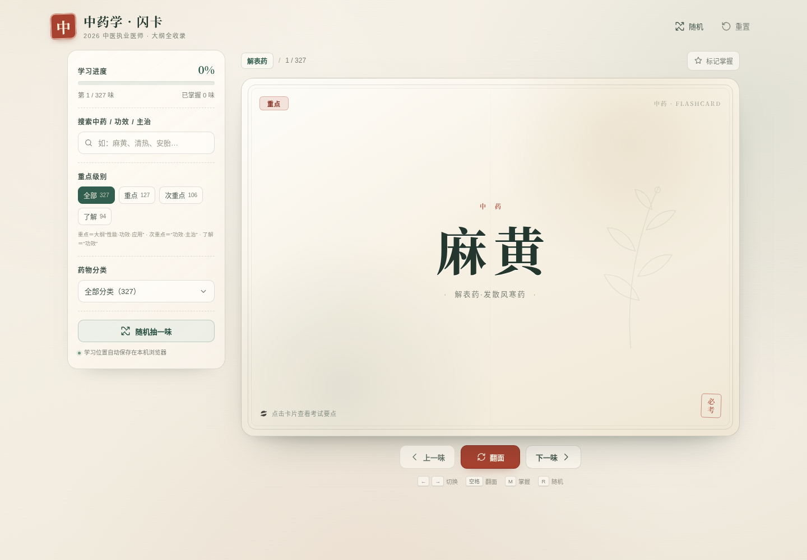

# 中医中药学 · 执业医师闪卡

面向 **2026 年中医执业医师资格考试** 的中药学记忆闪卡。中药数据单独存放在 `data/herbs.json`，页面使用原生 HTML + CSS + JavaScript，无框架、无外部依赖。



## 快速开始

在项目目录运行：

```bash
./start.sh
```

或：

```bash
python3 -m http.server 8000
```

浏览器打开 <http://localhost:8000>。首次使用建议直接运行 `./start.sh`，脚本会自动选择可用端口并尝试打开浏览器。

> 不能直接双击 `index.html` 打开：浏览器会禁止页面读取本地 JSON 文件。必须通过上面的本地服务器访问。

## 部署到 GitHub Pages

本项目是纯静态站点，已附带 GitHub Pages 自动部署配置：

- `.github/workflows/pages.yml`
- `.nojekyll`

### 方式一：GitHub Actions 自动部署（推荐）

1. 在 GitHub 新建一个仓库（例如 `tcm-flashcard`）。
2. 在本目录初始化 Git 并推送：

```bash
cd /home/jtz/Development/Workflow/tcm-flashcard
git init
git add .
git commit -m "中医中药学执业医师闪卡"
git branch -M main
git remote add origin https://github.com/<你的用户名>/<仓库名>.git
git push -u origin main
```

3. 打开仓库的 **Settings → Pages → Build and deployment**。
4. 将 **Source** 设为 **GitHub Actions**。
5. 等待 **Actions** 中的 `Deploy static flashcard to GitHub Pages` 运行完成。
6. 访问 `https://<你的用户名>.github.io/<仓库名>/`。

如果仓库名是 `<你的用户名>.github.io`，访问地址则是 `https://<你的用户名>.github.io/`。

以后每次 `git push` 到 `main`（或 `master`）都会自动重新部署。

### 方式二：从分支直接发布（不用 Actions）

1. 将项目推送到 GitHub 的 `main` 分支。
2. 打开 **Settings → Pages → Build and deployment**。
3. **Source** 选择 **Deploy from a branch**。
4. Branch 选择 `main`，目录选择 `/(root)`，保存。
5. 访问 `https://<你的用户名>.github.io/<仓库名>/`。

项目里的 `.nojekyll` 会阻止 Jekyll 处理静态文件，`data/herbs.json`、`assets/` 等相对路径可直接使用。两种方式选一种即可，不要同时使用。

### 部署注意事项

- GitHub Pages 是 HTTPS 静态托管，不需要 `start.sh` 或 Python 服务器。
- 学习进度保存在浏览器的 `localStorage` 中，且按网站域名隔离：`localhost` 上的进度不会自动带到 GitHub Pages，反之亦然。
- 如果更新后页面仍是旧版本，等待 Actions 完成并强制刷新浏览器（`Ctrl/Cmd + Shift + R`）。
- 私有仓库能否使用 Pages 取决于 GitHub 账户套餐；公开仓库可直接使用。

## 功能

- **大纲全收录**：按 2026 版中医执业医师《中药学》考试大纲（沿用 2025 版）及官方指导用书整理，共 **327 味**中药、**46 个分类**，与官方大纲逐条核对。
- **重点分级**：每味药标注「重点 / 次重点 / 了解」，可按级别筛选。分级直接对应大纲要求：**重点**＝大纲要求“性能、功效、应用”；**次重点**＝“功效、主治病证”；**了解**＝“功效”或低频考点。
- **正面识药，背面考点**：正面只显示中药名；背面包含性味归经、功效、主治、用法用量、使用注意、高频考点、易错点。
- **位置记忆**：自动保存当前中药、卡片正反面、筛选级别和分类。关闭浏览器再打开，会恢复到上次看到的药物，并提示恢复位置。
- **掌握标记**：可标记「已掌握」，统计保存在本机。
- **搜索与随机**：可按药名、功效、主治、考点搜索；可随机抽一味自测。
- **键盘操作**：`←` / `→` 切换，`空格` 翻面，`M` 标记掌握，`R` 随机。
- **移动端适配**：手机上通过左上角筛选按钮打开侧栏。

学习记录保存在浏览器 `localStorage` 的 `tcm-materia-flashcards-v1` 键中。清除浏览器网站数据会一并清除学习记录。

## 数据文件

`data/herbs.json` 是一个 JSON 数组，每味药包含以下字段：

```json
{
  "name": "麻黄",
  "category": "解表药·发散风寒药",
  "priority": "重点",
  "nature": "辛、微苦，温；归肺、膀胱经。",
  "effects": "发汗解表，宣肺平喘，利水消肿。",
  "indications": "风寒表实无汗；咳嗽气喘；风水水肿。",
  "usage": "2~10g，煎服；发汗宜生用，止咳平喘多炙用。",
  "caution": "表虚自汗、阴虚盗汗、肾虚喘咳者忌用。",
  "points": "发汗解表要药；表实无汗兼喘、水肿最宜。",
  "trap": "麻黄发汗力强，主表实无汗；桂枝解肌发表，表虚有汗亦可用。"
}
```

字段说明：

| 字段 | 含义 |
| --- | --- |
| `name` | 中药名 |
| `category` | 章节与细目 |
| `priority` | 重点级别：`重点` / `次重点` / `了解` |
| `nature` | 性味归经 |
| `effects` | 功效 |
| `indications` | 主治病证 |
| `usage` | 用法用量、特殊煎服法 |
| `caution` | 使用注意与禁忌 |
| `points` | 高频考点 |
| `trap` | 易错点、相似药鉴别 |

数据分片位于 `data/part-*.json`，修改后运行以下命令重新合并、校验并生成 `data/herbs.json`：

```bash
python3 scripts/build_data.py
```

## 目录

```text
tcm-flashcard/
├── index.html
├── styles.css
├── app.js
├── start.sh
├── .nojekyll
├── .github/workflows/pages.yml
├── data/
│   ├── herbs.json          # 前端实际读取的数据
│   └── part-*.json         # 按章节拆分的数据源
└── scripts/
    └── build_data.py       # 合并、校验、生成 herbs.json
```

## 范围与说明

- 依据国家卫生健康委员会医师资格考试委员会公布的《中医类别医师资格考试大纲（2025 年版）》中“中医执业医师·中药学”部分逐条整理；2026 年考试大纲明确继续沿用该版。
- 收录 2025 版大纲中的**重楼、白蔹、半枝莲、芦荟、徐长卿、路路通、雷公藤、苎麻根**等；不收录旧版中的**稻芽、降香**。**罗布麻叶**仍在本版大纲中，故予保留。
- 2026 版官方指导用书的中药学微调已吸收，如“紫苏叶”写作“紫苏”、石菖蒲新增噤口痢应用。
- 内容用于考试复习，不构成临床处方或用药建议。具体考试范围、剂量与禁忌请以国家医学考试中心最新大纲和官方指导用书为准。

参考：

- [国家卫生健康委：中医类别医师资格考试大纲（2025 年版）](http://www.nhc.gov.cn/yzygj/s7655/202501/c86b948d7efd48449fe210eee65cdfe9.shtml)
- [2026 年中医执业医师《综合笔试》考试大纲（医学教育网）](https://www.med66.com/zhongyiyishi/dagang/li2602014170.shtml)
- [2026 年中医类医师考试教材变动说明](https://www.sohu.com/a/983752819_656872)
